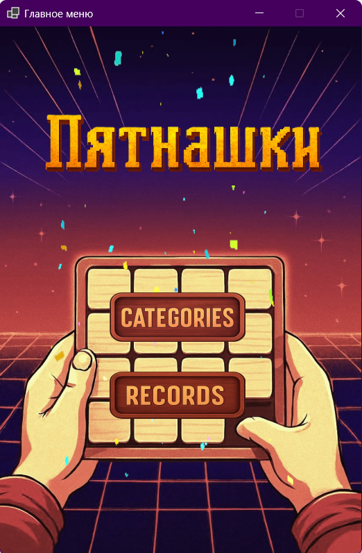
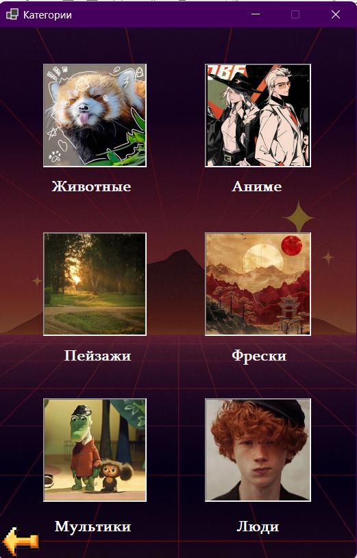
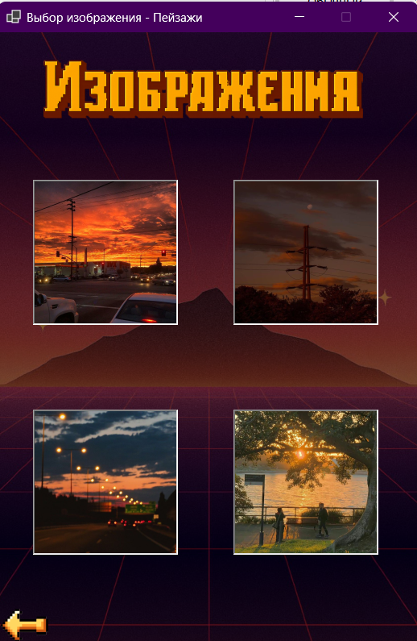
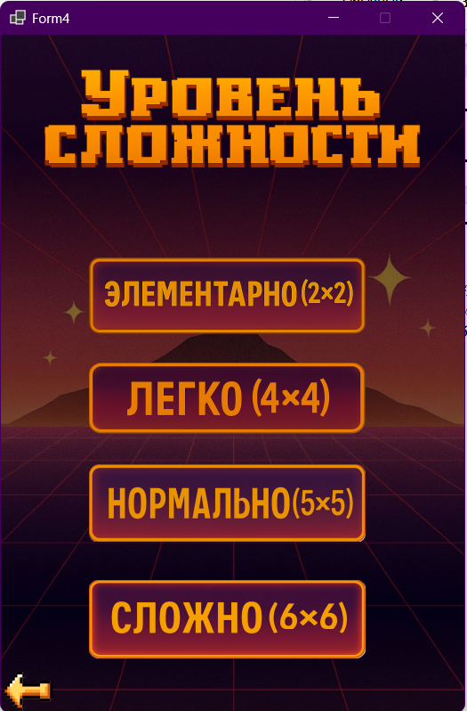
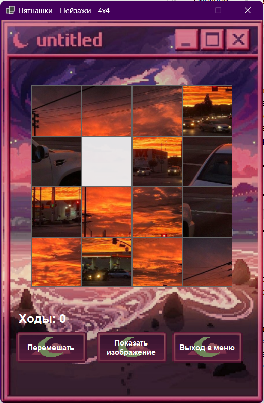
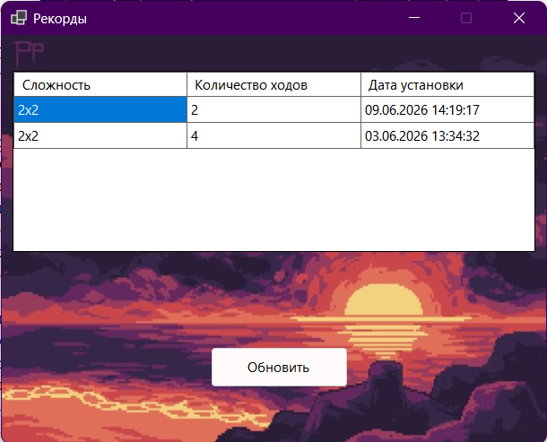

# Игра пятнашки
Курсовая работа по C#. Игра "Пятнашки с выбором различных изображений и уровней сложности.
## Технологии
- C#
- Windows Forms
- JSON

## Как скачать
1. Клонируйте репозиторий через Visual Studio:
   - Откройте Visual Studio --> "Клонировать репозиторий"
   - Вставьте ссылку: https://github.com/alis8black-pixel/Puzzle_15.git
   - Нажмине "Клонировать"
   - Откройте 'Пятнашки.csproj' или 'Пятнашки.slnx' 
2. Нажмите F5 для  сборки и запуска проекта

3. Если скачали zip нужно снять веб-метки:
   для этого перейдите в проводник, правой кнопкой мыши по файлу --> свойства --> разблокировать
   
## Как играть
- Запустить приложение
- Выбрать категорию изображения
- Выбрать понравившееся изображение
- Выбрать уровень сложности
- Перемещать фишки, которые соседствуют с пустой, стремясь собрать оригинальную картинку
- При сложностях можно заново перемешать фишки, использовав кнопку "Перемешать" либо открыв и посмотрев оригинальное изображение с помощью кнопки "Показать изображение"
- В окне "Рекорды" отображается минимально сделанное количество ходов для сбора изображения для различных уровней сложности

## Скриншоты
| Главное меню | Категории | Изображения |
|:---:|:---:|:---:|
|  |  |  |
| Уровни сложности | Игровое поле | Рекорды |
|  |  |  |
